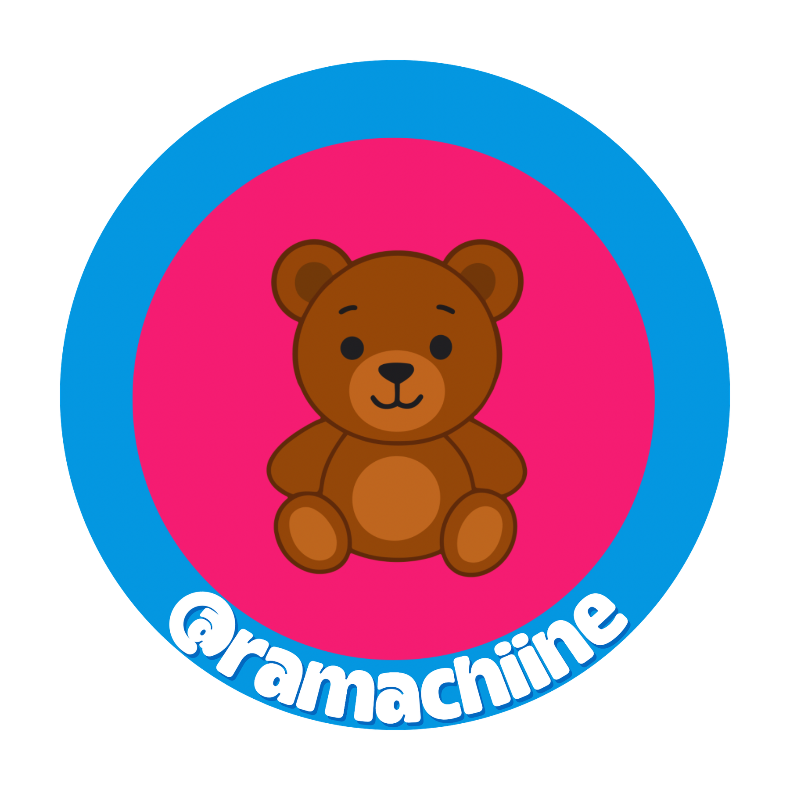
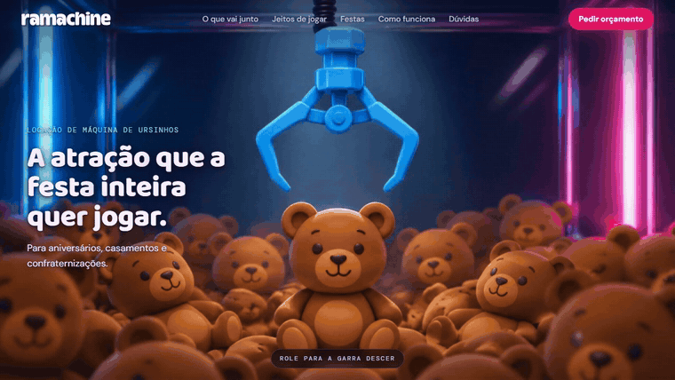
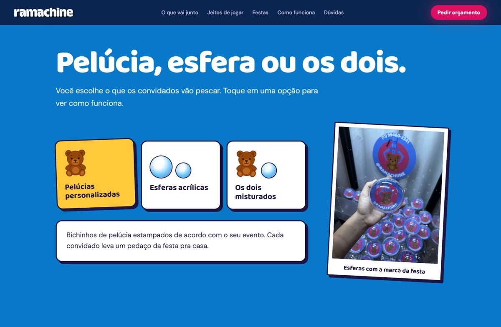
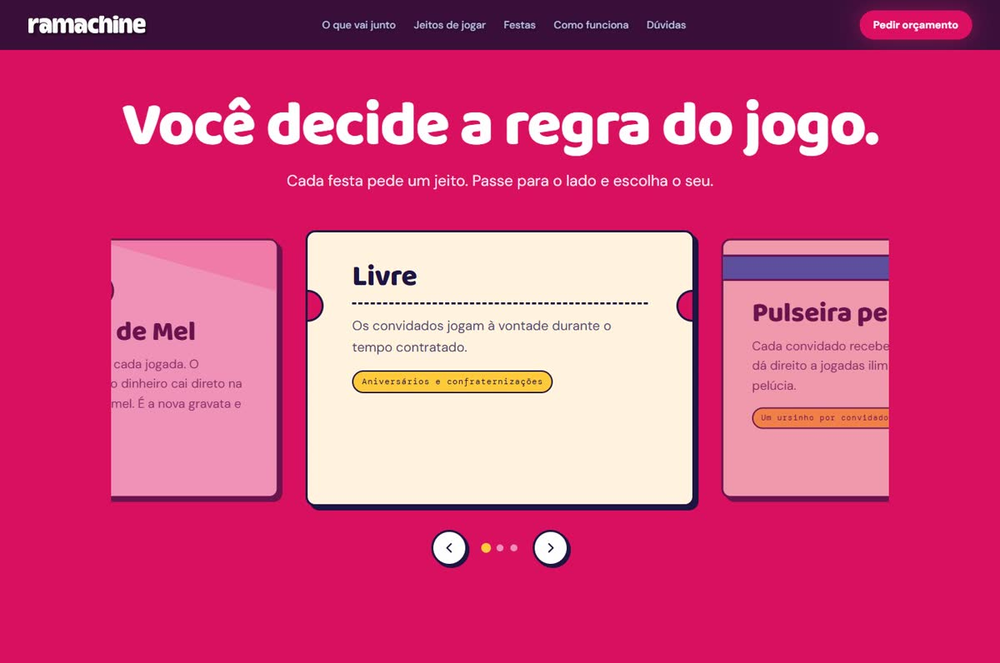
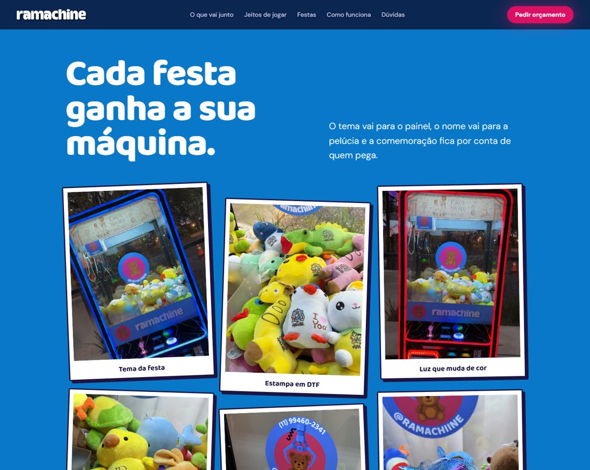
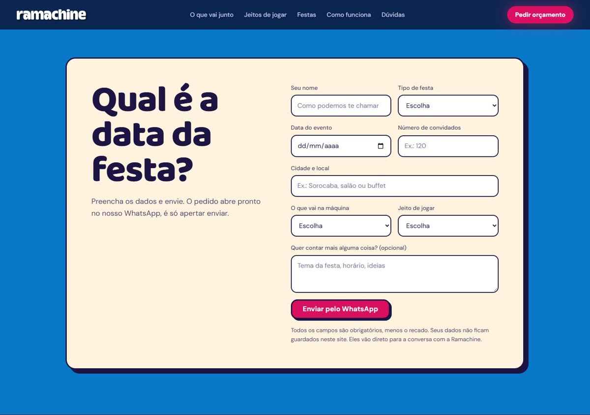
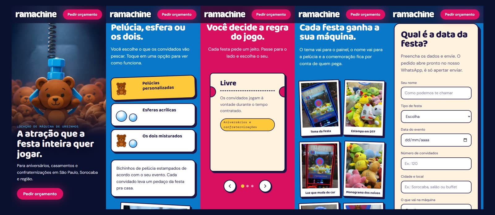

# Ramachine

**Landing page para locação de máquina de ursinhos em eventos**

[www.ramachine.com.br](https://www.ramachine.com.br)

## Sobre o projeto

Landing page criada para a Ramachine, empresa que realiza locação de máquina de ursinhos para aniversários, casamentos e confraternizações em São Paulo, Sorocaba e região.

Essa landing page foi criada com o objetivo de filtrar melhor os leads e de apresentar o serviço realizado pela empresa, tirando possíveis dúvidas.

## Destaques

**A garra desce com o scroll.** O topo é um vídeo que anda junto com a rolagem da página: a garra desce, abraça o ursinho da marca e ele brilha quando é pego. O vídeo foi gerado com IA a partir do ursinho do logo.

**Pedidos que já chegam qualificados.** O formulário pede data, cidade, número de convidados, o que vai na máquina e o jeito de jogar. Ao enviar, o pedido abre pronto no WhatsApp da empresa, com todas as informações para o orçamento.

**O serviço explicado antes da primeira mensagem.** O que está incluso, as opções de pelúcia ou esfera acrílica, os três jeitos de jogar, o passo a passo e as dúvidas mais comuns ficam respondidos na própria página.

**Prova real.** Fotos e vídeos de eventos, e depoimentos de clientes transcritos das mensagens recebidas depois das festas.

**Interações no tema.** Um botão de segurar para "pescar" o ursinho, abas para escolher o que vai na máquina e um carrossel infinito com os jeitos de jogar.

**Pensado para o celular.** No celular, o topo mostra uma imagem leve no lugar do vídeo, e cada parte foi ajustada para a tela pequena.

## Telas

### No celular

## Feito com

- HTML, CSS e JavaScript puros, sem framework e sem etapa de build
- Vídeo do topo gerado com IA no Higgsfield e preparado com ffmpeg para andar com o scroll
- Hospedagem na Vercel, com domínio próprio
- Google Tag Manager e Google Analytics 4, com aviso de cookies e modo de consentimento (LGPD)

A página inteira pesa cerca de 24 KB comprimida. Vídeos e imagens carregam só quando são necessários.

## Direitos

Este repositório está público como portfólio. Ele não tem licença de uso: o código pode ser visto, mas não copiado ou reutilizado sem autorização.

A marca Ramachine, o ursinho, as fotos, os vídeos e os depoimentos pertencem à Ramachine e não podem ser usados em outros projetos.
